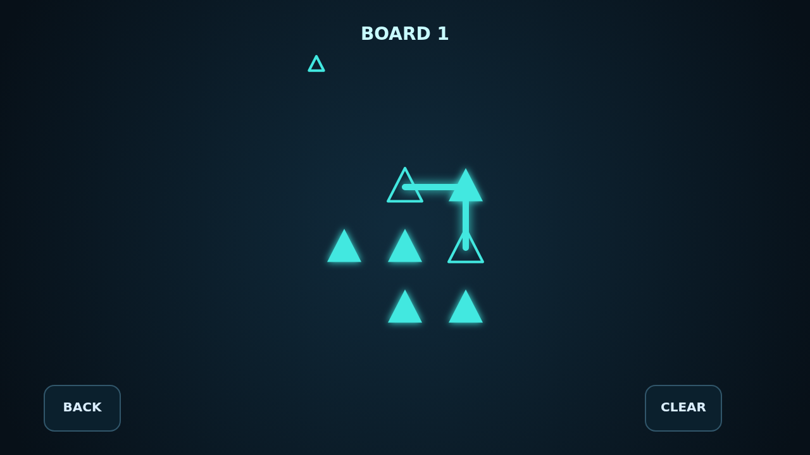

# Draw the light

Refract turns a dark optical bench into a bright, tactile logic puzzle. Press an outlined emitter and draw its beam from node to node, watching each connection glow into place.

Every beam must reach its matching emitter and thread all filled lenses of its color. Neutral crystals can carry any beam, but every charge must be spent exactly once—and light can neither share a segment nor cross on a diagonal.

Campaign is a carefully paced course of 24 boards, from compact single-beam studies to crowded three-color challenges. Cascade keeps generating fresh boards and climbs through five difficulty tiers for an endless run.

